# Connected Rider Agent Workflow

This guide connects the [Rider Evidence Agent](rider-evidence-agent.md), [Rider Policy Agent](rider-policy-agent.md), and [Rider Advocate](rider-advocate.md) using the stages in the project's [workflow](../../../workflow.md). It is a shared Markdown integration specification; it does not connect or execute the agents in the app.

The application and orchestrator pass validated records through the shared Case store. Arrows below represent those logical handoffs, not private messages between agents. The Driver Advocate, shared policy assessment, Judge, and human-review process are integration boundaries described in the main workflow, not new executable agents supplied here.

## One connected flow

```mermaid
flowchart TB
    REPORT["1 · Submit dispute<br/>Rider supplies Trip, category, identity,<br/>claim and requested remedy"]
    INTAKE{"2 · Validate intake<br/>Application checks Trip and category"}
    REJECT["Reject invalid input<br/>Clear error; no interactive request<br/>for missing details"]
    REPORT --> INTAKE
    INTAKE -->|Invalid| REJECT

    subgraph EVIDENCE["3 · Gather evidence"]
        RE["Rider Evidence Agent<br/>Support the Rider Advocate's evidence retrieval"]
        OTHER["Other authorized evidence tools<br/>Driver records and optional image findings"]
        ESTORE[("Shared Case store<br/>Traceable records, relevance,<br/>missing data and conflicts")]
        RE --> ESTORE
        OTHER --> ESTORE
    end
    INTAKE -->|Valid report snapshot| RE
    INTAKE -->|Valid Case| OTHER

    subgraph POLICY["4 · Retrieve policy"]
        SOURCE[("One versioned policy source")]
        RP["Rider Policy Agent<br/>Use the report and stored evidence context<br/>to retrieve relevant Rider clauses"]
        PSTORE[("Shared Case store<br/>Full policy result and relevance<br/>bound to the same report")]
        SOURCE --> RP
        RP --> PSTORE
    end
    ESTORE -->|Step 3 result and original report references| RP
    PSTORE --> GATE{"Ready for step 5?<br/>Same report and policy version;<br/>shared evidence sealed; gaps handled"}
    GATE -->|No| HOLD["Record failure or incomplete stage<br/>Configured retry or review"]

    subgraph CASES["5 · Build cases"]
        RA["Rider Advocate<br/>Combine claims, evidence and policy<br/>Address counter-evidence"]
        DA["Driver Advocate<br/>Independent driver case"]
        SUB["Application validates and saves<br/>Both Submissions and source versions"]
        RA --> SUB
        DA --> SUB
    end
    GATE -->|Ready: both complete Rider outputs| RA
    GATE -->|Ready: same sealed evidence and policy| DA
    PSTORE -.->|Stored policy brief and same source version| SHARED["Shared policy assessment<br/>Both policy roles when enabled"]
    DRIVERPOLICY["Driver policy role<br/>Same version through the store"] -.-> SHARED
    SUB -->|Both valid Submissions| JUDGE["6 · Review and rule<br/>Judge compares both cases with source evidence<br/>and policy; configured human review when required"]
    SHARED -.->|Assessment when enabled| JUDGE
    GATE -.->|Sealed evidence and fixed policy| JUDGE
    JUDGE --> NOTIFY["7 · Communicate outcome<br/>Application delivers the same decision<br/>to Rider and Driver"]
    NOTIFY --> COMPLETE["8 · Complete case<br/>Application records action and execution status<br/>and preserves Case and Communication Log"]

    classDef core fill:#dbeafe,stroke:#2563eb,color:#172554
    classDef optional fill:#f3e8ff,stroke:#9333ea,color:#581c87
    classDef data fill:#f1f5f9,stroke:#64748b,color:#0f172a
    classDef decision fill:#fef3c7,stroke:#d97706,color:#78350f
    class RA,DA,JUDGE core
    class RE,RP,SHARED,DRIVERPOLICY optional
    class SOURCE,ESTORE,PSTORE data
    class INTAKE,GATE decision
```

## Operational steps from workflow.md

This sequence follows [Operational Steps](../../../workflow.md#operational-steps) in order. The table keeps the original owners: the advocates own evidence/policy retrieval, with the two Supporting Agents performing that work when enabled. The application/orchestrator dispatches and stores it; it does not transfer case-building responsibility to those Supporting Agents.

| Step | Workflow owner | Connection between the three Rider agents | Required handoff |
| --- | --- | --- | --- |
| 1. Submit dispute | Rider or Driver | Rider submits Trip reference, category, identity, claim, and requested remedy. The application preserves the original report for all three roles. | Application-owned report/Case reference linked to the Trip; no agent invents an identifier. |
| 2. Validate intake | Application | Check Trip and category before starting the Rider Evidence Agent. Invalid input is rejected with a clear error; there is no interactive request for missing details. | Validated report snapshot and Case association, or rejection. |
| 3. Gather evidence | Both advocate agents using evidence tools | On the Rider side, delegate scoped retrieval to the Rider Evidence Agent when enabled. It collects relevant records and returns the unchanged collection, relevance, missing data, and conflicts through the shared store. | Stored `evidence_output_ref` and original report reference for step 4 and the eventual Rider Advocate input. |
| 4. Retrieve policy | Both advocate agents using policy tools | Invoke the Rider Policy Agent after the step 3 result is recorded. Supply the same report, stored evidence context, and fixed policy source. It returns full relevant clauses, conditions, coverage, and limitations; references also reach shared policy assessment/Judge. | Stored `policy_output_ref`, fixed policy references, and the retained step 3 evidence. |
| 5. Build cases | Rider and Driver Advocate Agents | Rider Advocate receives both complete outputs, original report, whole sealed evidence set, and the same policy version. It builds the rider case independently of the Driver Advocate. | Two validated structured Submissions with facts, counter-evidence, citations, and requested outcomes. |
| 6. Review and rule | Judge Agent | Judge compares both Submissions against underlying evidence and policy, explaining accepted/rejected arguments. Configured human review follows the main workflow. | Ruling, action, reasoning summary, and confidence. |
| 7. Communicate outcome | Application | Deliver the same decision to both parties with party-relevant wording. None of the three Rider agents sends a final decision on its own. | Rider and Driver notifications. |
| 8. Complete case | Application | Record recommended action and its execution status when implemented, then preserve the Case and Communication Log. Pending/failed actions follow the main workflow's closure rules. | An auditable completed Case. |

## Agent responsibilities and handoffs

| Role | Receives | Produces | Consumer through the shared store |
| --- | --- | --- | --- |
| [Rider Evidence Agent](rider-evidence-agent.md) | Validated Rider, Trip, original report and its snapshot reference. | Unchanged `collection` plus proposed `selection`: relevant Evidence Item references, report-field links, gaps, conflicts, and status. | Rider Advocate; collected records also enter the shared evidence set for both advocates and the Judge. |
| [Rider Policy Agent](rider-policy-agent.md) | The same report snapshot, stored step 3 evidence context, and the Case's fixed policy snapshot. | Proposed adapter: unchanged `policy_result`, full `relevance`, `coverage`, `review_signals`, `context`, policy snapshot reference, errors, and overall status. | Rider Advocate and shared policy assessment; authoritative policy remains accessible to both advocates and Judge. |
| [Rider Advocate](rider-advocate.md) | Original report, both complete supporting outputs, the whole sealed evidence set, and fixed policy source. | One independent rider Submission with claims, evidence IDs, clause IDs, counter-arguments, requested outcome, and source/version references. | Application validates and stores it; Judge receives it alongside the independent Driver Submission. |

The Rider sequence is **validated report → step 3 Rider Evidence Agent → step 4 Rider Policy Agent → step 5 Rider Advocate**. Both supporting outputs are retained; the Policy Agent does not replace or rewrite the evidence output. Its evidence context helps explain which clause conditions need verification, without converting a Rider claim into an established fact. If policy retrieval exposes another evidence gap, the orchestrator records it and, when further collection is configured, repeats step 3 before refreshing step 4. If facts change after sealing, reseal a new shared evidence version and rebuild both Submissions.

## Shared identity and version references

The following is a **proposed application handoff manifest**, not an existing JavaScript response or an amendment to the shared contract. It joins stored artifacts without merging or overwriting their source payloads.

| Logical reference | Required meaning |
| --- | --- |
| `context.case_ref` | Application-owned eligible Case reference. Preview-only reports do not have a Case-ready handoff. |
| `context.rider_id`, `context.trip_id` | Validated Rider and associated Trip. Compare them with the evidence collection's `rider_id` / `trip_id` and selection context. |
| `context.report_ref` | Application reference resolving to one immutable report snapshot: an ID plus revision, or an immutable snapshot reference. Client `DEMO-…` IDs alone do not identify a revision. |
| `policy_version`, `policy_snapshot_ref` | One fixed version and its complete source snapshot. Must agree with `policy_output.policy_result.policy_version` and the policy adapter's snapshot reference. |
| `evidence_version` | The complete shared evidence version sealed by the orchestrator before advocacy. Evidence Item IDs must resolve within it. |
| `evidence_output_ref` | Stored evidence-role result and its actual write receipt, bound to this report snapshot: Agent output when enabled, or validated authorized-tool output on the fallback path. |
| `policy_output_ref` | Stored policy-role result and its actual write receipt, bound to this report snapshot and policy source: Agent adapter output when enabled, or validated shared-policy-tool output on the fallback path. |
| `producers` | Actual agent/tool producers and supporting-role switch settings. A fallback result must never be attributed to an agent that did not run. |
| `rider_submission_ref` | Stored, validated Submission plus its report/evidence/policy references; populated only after a successful write. |

Here, `evidence_output` and `policy_output` mean the artifacts resolved from their references. The Policy Agent's `context` must match this manifest. The Evidence Agent's `selection.report_ref`, `selection.rider_id`, and `selection.trip_id` must agree with it; its unchanged raw collection is associated with the same snapshot by the application. Report references may have different storage representations only if the application resolves them to the exact same immutable source.

The current collectors do not return this manifest or all adapter fields. Raw `RiderEvidenceAgent.collect(...)` and `RiderPolicyAgent.match(report)` responses can seed future adapters, but must not be labelled fully connected or ready without the provenance, relevance, storage, and readiness checks above.

## Readiness within the operational steps

- **Step 2 → step 3:** only a validated, supported report starts investigation. Preserve rejected intake separately; do not invent a Trip or active Case.
- **Step 3 → step 4:** save and validate evidence source references and the report binding first. Evidence `selection.status` is `ready`, `partial`, `awaiting_report`, or `blocked`. Awaiting/blocked results cannot be passed as completed evidence; a partial result proceeds only under the configured requirements, with every gap visible. Missing Evidence Items alone do not prove fault.
- **Step 4 → step 5:** save the complete policy output with exact clause/version and report-field citations. Policy adapter `status` is `ready`, `partial`, or `blocked`; nested matcher `matched` cannot override it. Partial coverage requires an explicit configured decision permitting a qualified Submission, otherwise retry or route for review. Combine authorized records into one sealed evidence version before either advocate builds a case. Preserve configured safety/review signals.
- **Step 5 → step 6:** Rider Advocate uses all `policy_output.relevance`, coverage, limitations, and review signals alongside `evidence_output.selection` and the full sealed set. Both advocates use the same versions and cannot inspect each other's Submission. Judge waits for both valid Submissions and enabled shared policy assessment.
- **Steps 6 → 7 → 8:** the Judge/human-review path and application outcome/closure rules remain as specified in `workflow.md`. The three Rider roles do not execute payments or close the Case.

Report edits invalidate readiness for the changed snapshot. Preserve old outputs and Submissions with their original references, rerun affected retrieval, and rebuild both cases from consistent inputs. Reject cross-Case joins and policy-version mismatches. Use trusted idempotent writes and actual storage acknowledgements so retries do not duplicate active results or successful events. Bound retries/timeouts; schema/citation repair follows the architecture's maximum of two attempts before visible stage failure and review.

## Communication Log and fallback

Map the current Evidence Agent's `evidence_request` / `evidence_response` source events to the agreed Case log's `evidence_requested` / `evidence_returned`; retain their original source logs separately. The application also records `policy_retrieved`, `evidence_sealed`, and `submission_filed` only when their operations succeed. Every event is scoped to the Case and relevant snapshot/version, with concise results and references rather than private reasoning.

When Supporting Agents are disabled, use the MVP tool path in `workflow.md`. The orchestrator still provides report-bound evidence, fixed policy, and the same sealed shared set before independent advocacy. The application adapts actual tool results into equivalent validated role inputs using the agreed contracts, preserving raw source results and recording the real producer in `producers`. Mark the role as disabled; do not fabricate supporting-agent outputs or claim their adapters ran.

## Connection checks

- All three roles resolve the same Rider, Trip, Case, and immutable report snapshot.
- Evidence selection links to retained records; policy relevance links to exact clauses from one version.
- More than five relevant policies reach the Advocate through `relevance`, even if the preview displays fewer.
- Missing media, GPS, partial retrieval, and contradictory records remain visible across handoffs.
- Blocked inputs, stale revisions, unresolved citations, and failed writes cannot produce a successful Advocate or Judge handoff.
- Shared policy review receives the same policy output; both advocates and Judge retain access to the same underlying sources.
- The core tool path remains usable with supporting roles disabled; the Case still requires both validated Submissions.
